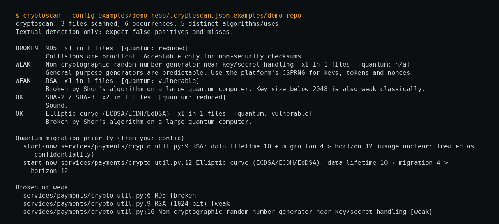

# cryptoscan

Inventory the cryptography in a codebase and decide which quantum-vulnerable uses to migrate first, using **your** numbers. Reads files only; no dependencies; Python 3.9+.

```bash
cryptoscan path/to/repo                                   # text inventory
cryptoscan path/to/repo --format cbom -o cbom.json        # CycloneDX CBOM
cryptoscan path/to/repo --format json --fail-on broken    # CI gate
cryptoscan path/to/repo --format sarif -o cryptoscan.sarif # GitHub code scanning / SARIF viewers
cryptoscan path/to/repo --min-confidence normal           # hide Python hits that are only declarations
```

Try it: `cd examples/demo-repo && PYTHONPATH=../../src python -m cryptoscan .`

## Prioritising migration

Create `.cryptoscan.json` (see `examples/demo-repo/.cryptoscan.json`):

```json
{
  "quantum_horizon_years": 12,
  "migration_years": 4,
  "signature_validity_years": 2,
  "paths": [{"glob": "services/payments/*", "data_lifetime_years": 10}],
  "ignore": ["tests/*"]
}
```

For each RSA, elliptic-curve or finite-field DH/DSA occurrence: if data lifetime + migration time > horizon, it is `start-now` (Mosca's inequality); otherwise `plan`. The numbers in the example are placeholders, **not predictions**: cryptoscan has no default horizon. Without numbers, occurrences are reported as `unassessed`. See [docs/RESEARCH.md](docs/RESEARCH.md) for sources, including NIST IR 8547 (still a draft as of the source I read).

## Declarations versus use (Python)

For `.py` files cryptoscan parses the source with `ast` and marks a hit `confidence: low` (with a `context`) when its line is a declaration rather than use: a docstring or bare string, an import (including multi-line imports), a member of an `Enum`/`Flag` class, or a module- or class-level assignment to an UPPER_CASE name whose value is only literals, a container of literals and names, or a re-export of the same name. Everything else, including every line inside a function body, any call, and any lower-case assignment, stays `normal`. By default all hits are shown and low-confidence ones are tagged in the text report; `--min-confidence normal` hides them and says how many were hidden, and `--fail-on` then follows what is shown. Committed private keys and certificates are never downgraded, because a key pasted into a constant is exactly the leak to catch. Other languages have no context pass and keep `normal`.

How far to trust it: it is a heuristic. On a slice of the Python 3.13 standard library (118 hits) it marked 20 as low and I read all 20; each was a docstring, import or constant, none was use. It does not catch everything: `ssl.py` still shows 9 of its original 17 hits, for example inside a class decorated with `@_simple_enum(...)` rather than deriving from an Enum, and in code that compares versions. That is intentional: a missed suppression costs a glance, a wrong suppression hides a real use.

## What it detects

MD5, SHA-1, DES, 3DES, RC4, ECB mode, RSA (flagging key sizes below 2048 when a size is visible within four lines), elliptic-curve algorithms and weak curves, finite-field DH/DSA, obsolete SSL/TLS versions, AES, ChaCha20, SHA-2/3, KDFs, post-quantum algorithms (ML-KEM, ML-DSA, SLH-DSA, Kyber, Dilithium, SPHINCS+, Falcon), weak random generators near key/token words, committed private keys (location only, contents never printed) and certificates.

## Limits

- **Textual matching on single lines.** No data flow, and parsing only for Python's declaration context (see above). For non-Python files it cannot tell using an algorithm from defining or listing it. On Python's own `ssl.py` the line rules report 15 obsolete-protocol hits that are mostly definitions; `--min-confidence normal` removes the ones the AST pass can prove are declarations.
- Misses indirect use (algorithm chosen by config, constant or dependency). Expect both false positives and false negatives.
- Comment lines and import lines are skipped; names inside strings are not.
- Usage (confidentiality vs signature) is guessed from nearby words.
- The CBOM output is validated against the official CycloneDX 1.6 JSON schema in the test suite (schema vendored under tests/ so the check runs offline).
- Algorithm status labels summarise common positions; check them against your own standards.

## Roadmap

Not done yet, in rough order of value:

- The same declaration-versus-use context for JavaScript/TypeScript, Java and Go (today only Python has it).
- Recognise decorator-driven enums and aliased imports in the Python context pass.

## Development

`python -m pytest tests/` (26 tests, including CBOM validation against the official CycloneDX 1.6 schema; jsonschema is a test-only dependency). Two real bugs (identifier boundaries and a DES pattern) were found by these tests while building it.

Not yet independently reviewed; the tests and documented limits describe what has been checked. MIT licence.

Designed and built by Maak — https://github.com/0xM44k

## Evidence



The image above is a capture of the command shown at the top of the image, run against the files in this repository on 2026-11-01. It is the tool's actual output, rendered in a terminal panel for legibility; no output lines were invented.
